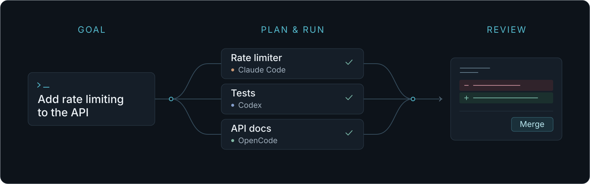
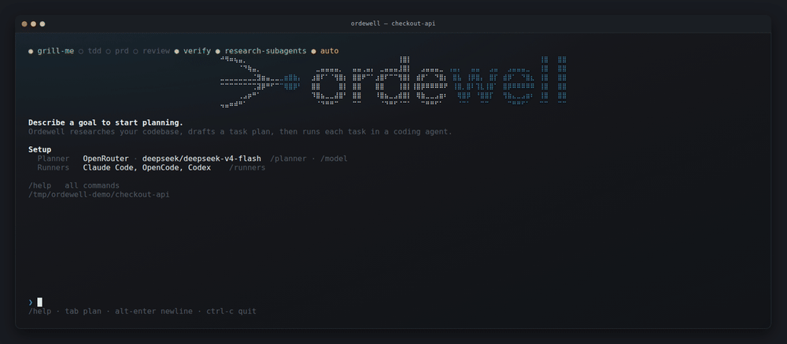

<p align="center">
  <picture>
    <source media="(prefers-color-scheme: dark)" srcset="assets/readme/logo-dark.png">
    
  </picture>
</p>

<p align="center">
  <strong>Stop juggling agent tabs. Talk to one planner.</strong><br>
  It runs Claude Code, Codex and six more coding agents for you, in plain sight. Review build plans before they run, or turn on autorun.
</p>

<p align="center">
  <a href="https://ordewell.ai"><strong>Website</strong></a> ·
  <a href="https://ordewell.ai/docs">Documentation</a> ·
  <a href="https://ordewell.ai/news">News</a>
</p>

<p align="center">
  <a href="LICENSE"></a>
  <a href="https://www.npmjs.com/package/@ordewell/cli"></a>
  <a href="https://github.com/ordewell/ordewell/actions/workflows/ci.yml"></a>
  <a href="https://github.com/ordewell/ordewell"></a>
</p>

<p align="center">
  
</p>

Describe what you want to build. Ordewell explores your repository, asks clarifying
questions, and turns your goal into a plan you can read and edit. Run independent
tasks in parallel, review the changes, and merge into your branch. Submitted build
plans wait for your approval by default; run settings let you automate execution
and merging.

Claude Code, Codex, OpenCode, GitHub Copilot CLI, Qwen Code, Cline, Gemini CLI and Cursor are supported out of the box,
and can be mixed freely within one plan. Install it on Linux or macOS with one
line, with no Node.js needed:

```bash
curl -fsSL https://ordewell.ai/install.sh | sh
```

This README describes 0.12.6. See the [published releases](https://github.com/ordewell/ordewell/releases)
for versions available to install and their release notes.

Ordewell is pre-1.0, so minor releases can include breaking changes. Read the
[changelog](CHANGELOG.md) before you upgrade.

## Features

<table>
  <tr><td><b>Editable plans</b></td><td>Change prompts, dependencies and each task's runner, model, thinking effort or mode before execution.</td></tr>
  <tr><td><b>Worktree isolation</b></td><td>Run code tasks in separate git worktrees, then review and merge their changes. See <a href="https://ordewell.ai/docs#isolation">isolation and handoff</a>.</td></tr>
  <tr><td><b>Check-and-fix loops</b></td><td>Repeat a check and its fix until it passes or reaches its round limit.</td></tr>
  <tr><td><b>More than code</b></td><td>Plan read-only research, operations and consented scripts alongside code tasks.</td></tr>
  <tr><td><b>Run controls</b></td><td>Watch tasks live, review their reports and choose whether to automate execution or merging.</td></tr>
  <tr><td><b>Usage limits</b></td><td>Tasks pause when an agent hits its account limit. Resume later or move unfinished work to another agent.</td></tr>
  <tr><td><b>Planner choices</b></td><td>Plan with a supported coding agent without an extra API key, or use an API provider. The planner reads your repository; changes run through tasks in the plan.</td></tr>
  <tr><td><b>Interfaces</b></td><td>Use the terminal UI, desktop app, VS Code extension, CLI or local API.</td></tr>
  <tr><td><b>Skills</b></td><td>Share your team's instructions in repository skills that the planner attaches to tasks across runners.</td></tr>
</table>

## Installation

On Linux and macOS the CLI and terminal UI install as one standalone binary:

```bash
curl -fsSL https://ordewell.ai/install.sh | sh
```

It installs to `~/.local/bin/ordewell`; set `ORDEWELL_INSTALL_DIR` to put it
elsewhere. Pass options after `sh -s --`: `--version X.Y.Z` for a specific
release, `--dry-run` to see what it would do, `--uninstall` to remove it, and
`--desktop` to install the [desktop app](#desktop-app) too. Run it again to
upgrade. With Homebrew:

```bash
brew install ordewell/tap/ordewell
```

Prefer npm, or on Windows, where the standalone binary is not available yet?
`npx ordewell` runs it without installing (Node.js 20.3 or newer). To keep it:

```bash
npm install -g ordewell
```

For VS Code, install [Ordewell from the Marketplace](https://marketplace.visualstudio.com/items?itemName=ordewell.ordewell)
or run `code --install-extension ordewell.ordewell`. In Cursor, Windsurf or VSCodium,
get it from [Open VSX](https://open-vsx.org/extension/ordewell/ordewell). The
extension bundles its own core and needs nothing from npm.

**Requirements:** a supported coding agent, installed and signed in. Node.js is
not required for the standalone binary; only the npm install needs 20.3 or
newer. git is optional: without it, or outside a git repository, tasks run
directly in the folder without worktrees. git 2.38 or newer is recommended, for
isolated worktrees, delegated tasks (a child plan needs its own worktree) and
Merge all.

The five ACP runners can also plan and run read-only tasks. Install GitHub
Copilot CLI 1.0.105+, Qwen Code 0.26.6+, Cline 3.0.74+, or Gemini CLI
0.66.0+ as applicable. Cursor CLI reports no version for Ordewell to check;
it was tested with 2026.10.22. Sign in through each agent's CLI, or use `/key`
to save a Google Gemini key for Gemini CLI. Cursor can change its own default
model when a writable task selects one. See the [0.12.6 changelog](CHANGELOG.md#0126---2026-11-05)
for runner-specific behavior and read-only restrictions.

### Windows

The VS Code extension, the full-screen terminal UI and the `ordewell` commands
(`plan`, `run`, `handoff` and the rest) run natively on Windows. Install Git
for Windows: the planner's research commands run in its shell. For Codex tasks,
[set up Codex's own sandbox](docs/troubleshooting.md#codexs-windows-sandbox-is-not-set-up)
once. Windows installs with npm for now, and the terminal UI's mouse and paste
need Node.js 22.17 or newer there.
See the [platform notes](https://ordewell.ai/docs#platforms) for setup and
current limitations.

## Quick start

Run `ordewell` in your project to open the terminal UI, then type a goal. The first
run lets you pick a planner and runners with `/planner` and `/runners`.

In VS Code, open your project folder and the Ordewell panel, then type a goal.
See the [extension guide](packages/vscode/README.md) for setup.

Ordewell also supports [command-line workflows](https://ordewell.ai/docs#first-plan)
for scripting.

Tried it? [Tell us how your first run went](https://github.com/ordewell/ordewell/discussions/115).

## Desktop app

Ordewell also runs as a desktop app for macOS, Windows and Linux: the planner,
the plan and its tasks, your repository's files, diffs and git, and a terminal,
in one window. It is a client of the same local daemon, so a run started there
is the one `ordewell status` reports. Each
[release](https://github.com/ordewell/ordewell/releases) attaches the
installers. Until releases are signed, the first launch on macOS or Windows
asks you to allow the app. The [desktop guide](docs/desktop/README.md) covers
installing it, running it from source and what the window holds.

### Install the desktop app

One line, for your user, with the download checked against the release's
checksums first:

```bash
# macOS and Linux
curl -fsSL https://raw.githubusercontent.com/ordewell/ordewell/main/scripts/install/desktop.sh | sh
```

```powershell
# Windows (PowerShell 5.1 or 7)
irm https://raw.githubusercontent.com/ordewell/ordewell/main/scripts/install/desktop.ps1 | iex
```

Run it again to upgrade; `--uninstall` (`-Uninstall` on Windows) removes it.
The scripts do not remove a macOS quarantine attribute or change any Windows
SmartScreen setting, and a file `curl` downloads carries no quarantine
attribute, so macOS treats it differently from a browser download.

A package manager can install the same release once it has published there:

```bash
# macOS
brew install --cask ordewell/tap/ordewell-desktop
```

```powershell
# Windows
winget install Ordewell.Ordewell
```

The cask was named `ordewell` before; it is `ordewell-desktop` now, and
`brew install ordewell/tap/ordewell` is the CLI. If you installed the cask
under its old name, Homebrew follows the rename on `brew update`.

Both are set up when the project's package-manager accounts and tokens exist;
the [desktop guide](docs/desktop/README.md#homebrew-and-winget) says what each
publishes and how it is set up. Until then, use one of the installers above.

Or download an installer. Each release has copies with a fixed name, so these
links always get the latest one:

- macOS: [Apple silicon `.dmg`](https://github.com/ordewell/ordewell/releases/latest/download/Ordewell-mac-arm64.dmg) · [Intel `.dmg`](https://github.com/ordewell/ordewell/releases/latest/download/Ordewell-mac-x64.dmg)
- Windows: [`.exe`](https://github.com/ordewell/ordewell/releases/latest/download/Ordewell-win-x64.exe)
- Linux: [`.AppImage`](https://github.com/ordewell/ordewell/releases/latest/download/Ordewell-linux-x64.AppImage) · [`.deb`](https://github.com/ordewell/ordewell/releases/latest/download/Ordewell-linux-x64.deb)
- [`SHA256SUMS`](https://github.com/ordewell/ordewell/releases/latest/download/SHA256SUMS), to check a download by hand: `sha256sum --ignore-missing -c SHA256SUMS` (`shasum -a 256 …` on macOS).

Options, the other install paths and what the checksum does and does not prove
are in the [desktop guide](docs/desktop/README.md#install).

## See it in action

<p align="center">
  
  <br>
  <sub>A real run, sped up where marked. <a href="https://ordewell.ai/assets/demo.mp4">Watch the full 48 seconds</a>.</sub>
</p>

## How it works

1. **Describe your goal.** The planner explores your workspace without modifying
   it and asks clarifying questions.
2. **Review the plan.** Edit tasks, dependencies, runners and models before
   approving the build plan.
3. **Run the tasks.** Independent tasks run in parallel; dependent tasks wait
   for the work they need. Follow progress live.
4. **Review and merge.** Read the diff and test evidence, then merge the changes
   into your branch or discard the run.

Autorun and automatic merging are off by default. During planning, research tasks
can start without build-plan approval, and script tasks can run with consent under
your approval and run settings. See [run settings](https://ordewell.ai/docs#run-settings).

The planner only reads; tasks run as you, in the mode the plan assigns. See
[SECURITY.md](SECURITY.md#what-each-part-can-touch) for what each part can touch.
Without a git repository or with isolation disabled, tasks share the workspace;
some files can also be shared between worktrees. See
[isolation and handoff](https://ordewell.ai/docs#isolation) for details.

## Documentation

The [documentation](https://ordewell.ai/docs) covers the planner options, skills,
commands, configuration and platform notes. Design decisions, including the options
that were rejected, are recorded as [architecture decision records](docs/adr/), and
[CONTEXT.md](CONTEXT.md) defines the project's vocabulary. For how the planner and
the runners each get their models and credentials, see
[planners and runners](docs/planners-and-runners.md). To write your own
planner or task skills, see the [skills guide](docs/skills.md). If Codex's
sandbox cannot start on your machine, see [troubleshooting](docs/troubleshooting.md).
For the experimental container mode, off in published versions, see
[running tasks in containers](docs/containers.md).

## Where it's going

- **Next:** bounded, standing consent for running on its own ([#23](https://github.com/ordewell/ordewell/issues/23)), an escalation inbox across surfaces ([#30](https://github.com/ordewell/ordewell/issues/30)) and a daemon that resumes plans after a restart ([#31](https://github.com/ordewell/ordewell/issues/31)).
- **In 0.11.0:** a planner that can start consented script tasks ([#107](https://github.com/ordewell/ordewell/issues/107)), read with a sandboxed shell that can loop and script ([#64](https://github.com/ordewell/ordewell/issues/64), [#109](https://github.com/ordewell/ordewell/issues/109)), keep talking while research tasks report back ([#111](https://github.com/ordewell/ordewell/issues/111)), and plan check-and-fix loops ([#118](https://github.com/ordewell/ordewell/issues/118)).
- **Shipped in 0.10:** the supervisor, which watches a run and, if you let it, acts within limits you set.

The full roadmap, and where to help, is in [#21](https://github.com/ordewell/ordewell/issues/21).

## Contributing

Contributions are welcome. Please read [CONTRIBUTING.md](CONTRIBUTING.md) for the
build order and project layout, and report security issues through
[SECURITY.md](SECURITY.md) rather than the public tracker.

Good places to start are the issues labelled
[good first issue](https://github.com/ordewell/ordewell/issues?q=is%3Aopen+label%3A%22good+first+issue%22)
and the [runner integrations](https://github.com/ordewell/ordewell/issues?q=is%3Aopen+label%3A%22runner+integration%22)
that are open for help.

## Acknowledgements

The grilling, spec, architecture and TDD skills are
adapted from [Matt Pocock's skills](https://github.com/mattpocock/skills) (MIT).

## What Ordewell sends

Ordewell checks for updates daily, sending its version and a random install ID
to ordewell.ai after a one-time notice. When a newer release exists, the CLI
says so: in a standalone install it points at re-running the installer or
`brew upgrade ordewell`, and in an npm install at `npm install -g`. To turn the check off, set
`ORDEWELL_NO_VERSION_CHECK=1` or `DO_NOT_TRACK=1`, or turn off VS Code's
telemetry for the extension. See [version check details](https://ordewell.ai/docs#version-check).

## License

Ordewell is licensed under the [Apache License 2.0](LICENSE). The Ordewell name and
logos are not covered by this license; see [NOTICE](NOTICE).
