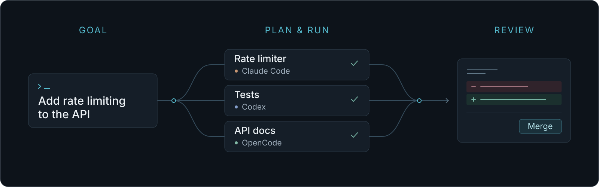
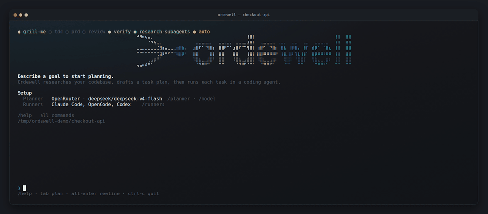

<p align="center">
  <picture>
    <source media="(prefers-color-scheme: dark)" srcset="assets/readme/logo-dark.png">
    
  </picture>
</p>

<p align="center">
  <strong>Stop juggling agent tabs. Talk to one planner.</strong><br>
  It runs Claude Code, Codex and OpenCode for you, in plain sight. Review build plans before they run, or turn on autorun.
</p>

<p align="center">
  <a href="https://ordewell.ai"><strong>Website</strong></a> ·
  <a href="https://ordewell.ai/docs">Documentation</a> ·
  <a href="https://ordewell.ai/news">News</a>
</p>

<p align="center">
  <a href="LICENSE"></a>
  <a href="https://www.npmjs.com/package/@ordewell/cli"></a>
  <a href="https://github.com/ordewell/ordewell/actions/workflows/ci.yml"></a>
  <a href="https://github.com/ordewell/ordewell"></a>
</p>

<p align="center">
  
</p>

Describe what you want to build. Ordewell explores your repository, asks clarifying
questions, and turns your goal into a plan you can read and edit. Run independent
tasks in parallel, review the changes, and merge into your branch. Submitted build
plans wait for your approval by default; run settings let you automate execution
and merging.

Claude Code, Codex and OpenCode are supported out of the box, and can be mixed
freely within one plan. Try it in your project, with nothing to install:

```bash
npx ordewell
```

This README describes 0.11.3. See the [published releases](https://github.com/ordewell/ordewell/releases)
for versions available to install and their release notes.

Ordewell is pre-1.0, so minor releases can include breaking changes. Read the
[changelog](CHANGELOG.md) before you upgrade.

## Features

<table>
  <tr><td><b>Editable plans</b></td><td>Change prompts, dependencies and each task's runner, model, thinking effort or mode before execution.</td></tr>
  <tr><td><b>Worktree isolation</b></td><td>Run code tasks in separate git worktrees, then review and merge their changes. See <a href="https://ordewell.ai/docs#isolation">isolation and handoff</a>.</td></tr>
  <tr><td><b>Check-and-fix loops</b></td><td>Repeat a check and its fix until it passes or reaches its round limit.</td></tr>
  <tr><td><b>More than code</b></td><td>Plan read-only research, operations and consented scripts alongside code tasks.</td></tr>
  <tr><td><b>Run controls</b></td><td>Watch tasks live, review their reports and choose whether to automate execution or merging.</td></tr>
  <tr><td><b>Usage limits</b></td><td>Tasks pause when an agent hits its account limit. Resume later or move unfinished work to another agent.</td></tr>
  <tr><td><b>Planner choices</b></td><td>Plan with a supported coding agent without an extra API key, or use an API provider. The planner reads your repository; changes run through tasks in the plan.</td></tr>
  <tr><td><b>Interfaces</b></td><td>Use the terminal UI, VS Code extension, CLI or local API.</td></tr>
  <tr><td><b>Skills</b></td><td>Share your team's instructions in repository skills that the planner attaches to tasks across runners.</td></tr>
</table>

## Installation

`npx ordewell` runs it without installing. To keep it:

```bash
npm install -g ordewell
```

For VS Code, install [Ordewell from the Marketplace](https://marketplace.visualstudio.com/items?itemName=ordewell.ordewell)
or run `code --install-extension ordewell.ordewell`. In Cursor, Windsurf or VSCodium,
get it from [Open VSX](https://open-vsx.org/extension/ordewell/ordewell). The
extension bundles its own core and needs nothing from npm.

**Requirements:** Node.js 20.3 or newer, at least one of Claude Code, Codex or
OpenCode, and git for task isolation.

### Windows

The VS Code extension runs natively on Windows. The terminal UI has not been
verified natively; run it under [WSL](https://learn.microsoft.com/windows/wsl/install).
See the [platform notes](https://ordewell.ai/docs#platforms) for setup and
current limitations.

## Quick start

Run `ordewell` in your project to open the terminal UI, then type a goal. The first
run lets you pick a planner and runners with `/planner` and `/runners`.

In VS Code, open your project folder and the Ordewell panel, then type a goal.
See the [extension guide](packages/vscode/README.md) for setup.

Ordewell also supports [command-line workflows](https://ordewell.ai/docs#first-plan)
for scripting.

Tried it? [Tell us how your first run went](https://github.com/ordewell/ordewell/discussions/115).

## See it in action

<p align="center">
  
  <br>
  <sub>A real run, sped up where marked. <a href="https://ordewell.ai/assets/demo.mp4">Watch the full 48 seconds</a>.</sub>
</p>

## How it works

1. **Describe your goal.** The planner explores your workspace without modifying
   it and asks clarifying questions.
2. **Review the plan.** Edit tasks, dependencies, runners and models before
   approving the build plan.
3. **Run the tasks.** Independent tasks run in parallel; dependent tasks wait
   for the work they need. Follow progress live.
4. **Review and merge.** Read the diff and test evidence, then merge the changes
   into your branch or discard the run.

Autorun and automatic merging are off by default. During planning, research tasks
can start without build-plan approval, and script tasks can run with consent under
your approval and run settings. See [run settings](https://ordewell.ai/docs#run-settings).

The planner only reads; tasks run as you, in the mode the plan assigns. See
[SECURITY.md](SECURITY.md#what-each-part-can-touch) for what each part can touch.
Without a git repository or with isolation disabled, tasks share the workspace;
some files can also be shared between worktrees. See
[isolation and handoff](https://ordewell.ai/docs#isolation) for details.

## Documentation

The [documentation](https://ordewell.ai/docs) covers the planner options, skills,
commands, configuration and platform notes. Design decisions, including the options
that were rejected, are recorded as [architecture decision records](docs/adr/), and
[CONTEXT.md](CONTEXT.md) defines the project's vocabulary. For how the planner and
the runners each get their models and credentials, see
[planners and runners](docs/planners-and-runners.md). To write your own
planner or task skills, see the [skills guide](docs/skills.md). If Codex's
sandbox cannot start on your machine, see [troubleshooting](docs/troubleshooting.md).

## Where it's going

- **Next:** bounded, standing consent for running on its own ([#23](https://github.com/ordewell/ordewell/issues/23)), an escalation inbox across surfaces ([#30](https://github.com/ordewell/ordewell/issues/30)) and a daemon that resumes plans after a restart ([#31](https://github.com/ordewell/ordewell/issues/31)).
- **In 0.11.0:** a planner that can start consented script tasks ([#107](https://github.com/ordewell/ordewell/issues/107)), read with a sandboxed shell that can loop and script ([#64](https://github.com/ordewell/ordewell/issues/64), [#109](https://github.com/ordewell/ordewell/issues/109)), keep talking while research tasks report back ([#111](https://github.com/ordewell/ordewell/issues/111)), and plan check-and-fix loops ([#118](https://github.com/ordewell/ordewell/issues/118)).
- **Shipped in 0.10:** the supervisor, which watches a run and, if you let it, acts within limits you set.

The full roadmap, and where to help, is in [#21](https://github.com/ordewell/ordewell/issues/21).

## Contributing

Contributions are welcome. Please read [CONTRIBUTING.md](CONTRIBUTING.md) for the
build order and project layout, and report security issues through
[SECURITY.md](SECURITY.md) rather than the public tracker.

Good places to start are the issues labelled
[good first issue](https://github.com/ordewell/ordewell/issues?q=is%3Aopen+label%3A%22good+first+issue%22)
and the [runner integrations](https://github.com/ordewell/ordewell/issues?q=is%3Aopen+label%3A%22runner+integration%22)
that are open for help.

## Acknowledgements

The grilling, spec, architecture and TDD skills are
adapted from [Matt Pocock's skills](https://github.com/mattpocock/skills) (MIT).

## What Ordewell sends

Ordewell checks for updates daily, sending its version and a random install ID
to ordewell.ai after a one-time notice. To turn the check off, set
`ORDEWELL_NO_VERSION_CHECK=1` or `DO_NOT_TRACK=1`, or turn off VS Code's
telemetry for the extension. See [version check details](https://ordewell.ai/docs#version-check).

## License

Ordewell is licensed under the [Apache License 2.0](LICENSE). The Ordewell name and
logos are not covered by this license; see [NOTICE](NOTICE).
