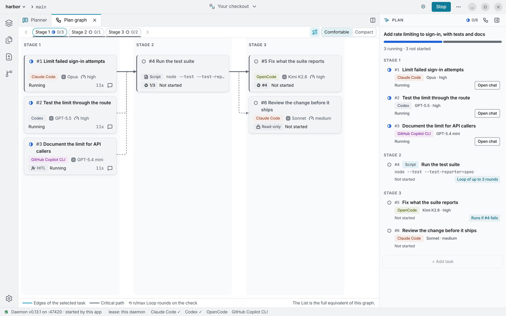
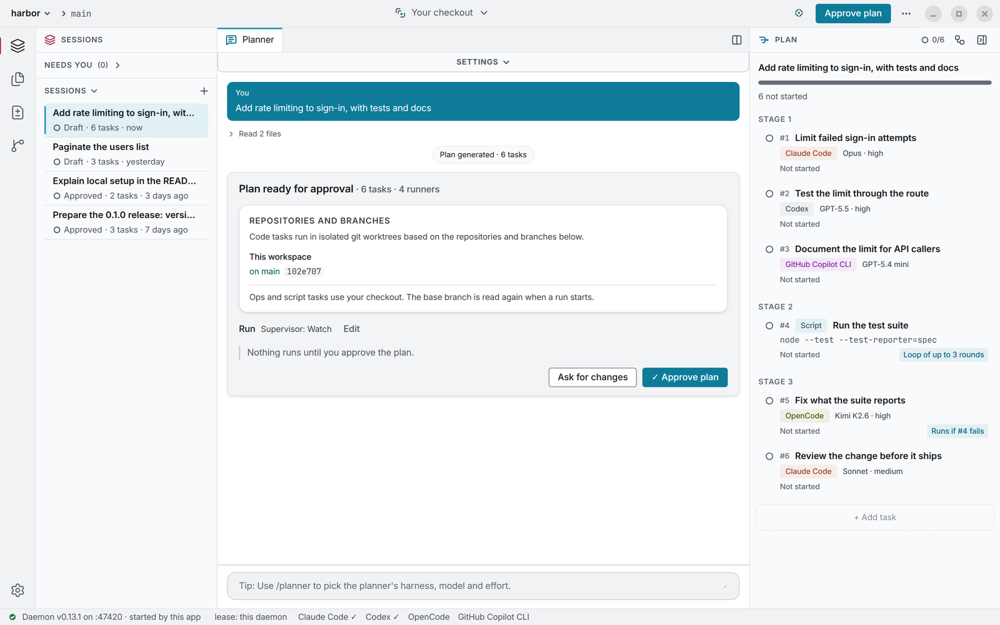
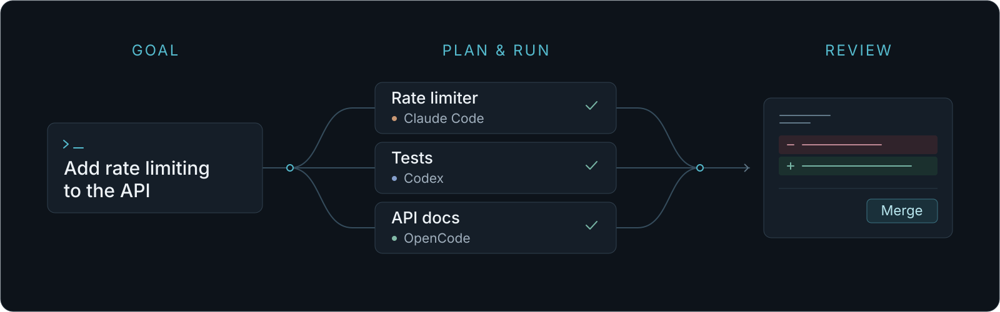
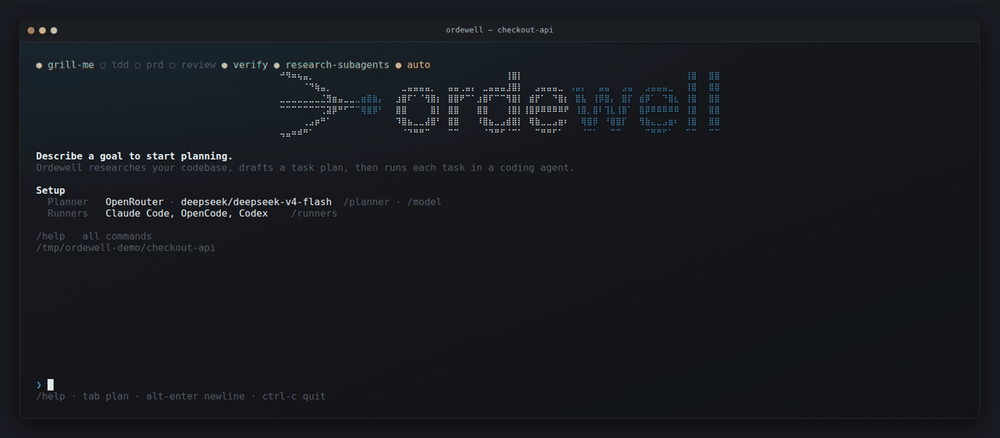

<p align="center">
  <picture>
    <source media="(prefers-color-scheme: dark)" srcset="assets/readme/logo-dark.png">
    
  </picture>
</p>

<p align="center">
  <strong>Stop juggling agent tabs. Talk to one planner.</strong><br>
  One goal, many agents, working in parallel. Review every step, or let it run.
</p>

<p align="center">
  <a href="https://ordewell.ai"><strong>Website</strong></a> ·
  <a href="https://ordewell.ai/download"><strong>Download</strong></a> ·
  <a href="https://ordewell.ai/docs">Documentation</a> ·
  <a href="https://ordewell.ai/news">News</a>
</p>

<p align="center">
  <a href="LICENSE"></a>
  <a href="https://www.npmjs.com/package/@ordewell/cli"></a>
  <a href="https://github.com/ordewell/ordewell/actions/workflows/ci.yml"></a>
  <a href="https://github.com/ordewell/ordewell"></a>
</p>

<p align="center">
  <picture>
    <source media="(prefers-color-scheme: dark)" srcset="assets/readme/desktop-run-dark.png">
    <source media="(prefers-color-scheme: light)" srcset="assets/readme/desktop-run-light.png">
    
  </picture>
  <br>
  <sub>The Ordewell desktop app. The real app on a demo project, with scripted agents.</sub>
</p>

Ordewell is the best agent orchestrator for complex work. One goal becomes a plan
graph you can edit, and each task gets its own agent, model and effort: Claude
Code, Codex, OpenCode, GitHub Copilot CLI and more. Independent tasks run in
parallel on their own branches, pass only on evidence, then merge. Review every
step, or let it run.

Use it in the [desktop app](#download-the-desktop-app), the
[terminal](#install-the-terminal-app), [VS Code](#vs-code) or from the command
line. Every one drives the same plans, runners and settings.

This README describes 0.13.4. See the [published releases](https://github.com/ordewell/ordewell/releases)
for versions available to install and their release notes.

## Why Ordewell

1. **A goal becomes a plan graph you can edit.** The planner reads your
   repository, asks what is vague and writes tasks with dependencies. Change any
   prompt, dependency, agent, model, effort or mode before it runs. The desktop
   app shows the plan as a list or as a graph.
2. **Every task picks its own agent.** Claude Code, Codex, OpenCode, GitHub
   Copilot CLI, Qwen Code, Cline, Gemini CLI and Cursor are supported out of the
   box and mix freely in one plan. Signed-in agents need no extra API key. A
   provider API key adds the built-in runner, which needs no coding agent
   installed ([planners and runners](docs/planners-and-runners.md#the-built-in-runner)).
3. **Parallel, without the pile-up.** Independent tasks run side by side, each
   on its own branch in its own git worktree; dependent tasks wait for the work
   they need, and a merge conflict gets a repair attempt before you are asked.
   Without a git repository, tasks share your folder.
4. **Done means evidence.** A task passes when its agent reports through
   `task_complete`, or when a script task exits cleanly. A clean exit with no
   report is a failure, and no second model decides. Check-and-fix loops repeat
   a check and its fix until it passes or reaches its round limit.
5. **Your call on autonomy.** By default you approve the plan, answer
   checkpoints and merge. Turn on autorun, automatic merging and an Act
   supervisor, and it runs and merges on its own; a merge conflict leaves your
   tree untouched and waits for you.

<p align="center">
  <picture>
    <source media="(prefers-color-scheme: dark)" srcset="assets/readme/desktop-plan-dark.png">
    <source media="(prefers-color-scheme: light)" srcset="assets/readme/desktop-plan-light.png">
    
  </picture>
  <br>
  <sub>A plan waiting for approval. The real app on a demo project, with scripted agents.</sub>
</p>

## Features

<table>
  <tr><td><b>More than code</b></td><td>Plan read-only research, operations and consented scripts alongside code tasks.</td></tr>
  <tr><td><b>Run controls</b></td><td>Watch tasks live, review their reports and choose whether to automate execution or merging.</td></tr>
  <tr><td><b>Worktree isolation</b></td><td>Run code tasks in separate git worktrees, then review and merge their changes. See <a href="https://ordewell.ai/docs#isolation">isolation and handoff</a>.</td></tr>
  <tr><td><b>Usage limits</b></td><td>Tasks pause when an agent hits its account limit. Resume later or move unfinished work to another agent.</td></tr>
  <tr><td><b>Planner choices</b></td><td>Plan with a supported coding agent without an extra API key, or use an API provider. The planner reads your repository; changes run through tasks in the plan.</td></tr>
  <tr><td><b>Interfaces</b></td><td>Use the desktop app, terminal UI, VS Code extension, CLI or local API.</td></tr>
  <tr><td><b>Skills</b></td><td>Share your team's instructions in repository skills that the planner attaches to tasks across runners.</td></tr>
</table>

## Download the desktop app

Get the installer for your computer from [ordewell.ai/download](https://ordewell.ai/download),
or straight from the latest release:

| OS | Download |
|---|---|
| macOS, Apple silicon | [Ordewell-mac-arm64.dmg](https://github.com/ordewell/ordewell/releases/latest/download/Ordewell-mac-arm64.dmg) |
| macOS, Intel | [Ordewell-mac-x64.dmg](https://github.com/ordewell/ordewell/releases/latest/download/Ordewell-mac-x64.dmg) |
| Windows | [Ordewell-win-x64.exe](https://github.com/ordewell/ordewell/releases/latest/download/Ordewell-win-x64.exe) |
| Linux | [Ordewell-linux-x64.AppImage](https://github.com/ordewell/ordewell/releases/latest/download/Ordewell-linux-x64.AppImage) or [Ordewell-linux-x64.deb](https://github.com/ordewell/ordewell/releases/latest/download/Ordewell-linux-x64.deb) |
| Checksums | [SHA256SUMS](https://github.com/ordewell/ordewell/releases/latest/download/SHA256SUMS) |

Or install it with one command, which picks the right installer and checks it
against the release's checksums before installing:

```bash
# macOS and Linux
curl -fsSL https://raw.githubusercontent.com/ordewell/ordewell/main/scripts/install/desktop.sh | sh

# the terminal app and the desktop app together
curl -fsSL https://ordewell.ai/install.sh | sh -s -- --desktop
```

```powershell
# Windows (PowerShell 5.1 or 7)
irm https://raw.githubusercontent.com/ordewell/ordewell/main/scripts/install/desktop.ps1 | iex
```

With a package manager, once the release has been published there:

```bash
brew install --cask ordewell/tap/ordewell-desktop   # macOS
winget install Ordewell.Ordewell                    # Windows
```

**The Windows installer may be unsigned.** Until the project's Windows
code-signing credentials are configured, SmartScreen shows **Windows protected
your PC** on first launch (choose **More info**, then **Run anyway**), and the
app does not update itself: when a new version is out, its notice offers
**Download** instead, and you install the next release yourself. A macOS build
opens without a prompt only when it is signed and notarized. The
[desktop guide](docs/desktop/README.md#install) covers each platform, the
checksums and updates.

The desktop app carries Electron and its own copy of the Ordewell daemon, so it
needs no Node.js.

## Install the terminal app

```bash
# macOS and Linux: a standalone binary, no Node.js needed
curl -fsSL https://ordewell.ai/install.sh | sh

# Homebrew
brew install ordewell/tap/ordewell

# npm: Windows, Alpine Linux, or if you prefer it (Node.js 20.3 or newer)
npm install -g ordewell
```

`ordewell update` upgrades Ordewell however you installed it. To see the
installer's options, such as another folder or uninstalling, run
`curl -fsSL https://ordewell.ai/install.sh | sh -s -- --help`.

**On Windows**, install with npm. [Git for Windows](https://gitforwindows.org/)
is required. The terminal UI runs natively; its mouse and paste need Node.js
22.17 or newer. See the [platform notes](https://ordewell.ai/docs#platforms).

### VS Code

Install Ordewell from the [Marketplace](https://marketplace.visualstudio.com/items?itemName=ordewell.ordewell).
In Cursor, Windsurf or VSCodium, get it from [Open VSX](https://open-vsx.org/extension/ordewell/ordewell).

### Requirements

A [supported coding agent](https://ordewell.ai/docs#runners), installed and
signed in, or a provider API key for the built-in runner. git is optional; 2.38
or newer is recommended: tasks then run in their own worktrees. Without it, they
run directly in your folder.

## Quick start

**Desktop app:** open Ordewell, choose **Open folder…** (or drop your project
folder on the window), then type a goal in the planner. The welcome window shows
which agents it found and whether each is signed in. See the
[desktop guide](docs/desktop/README.md).

**Terminal:** run `ordewell` in your project to open the terminal UI, then type a
goal. The first run lets you pick a planner and runners with `/planner` and
`/runners`.

**VS Code:** open your project folder and the Ordewell panel, then type a goal.
See the [extension guide](packages/vscode/README.md) for setup.

Ordewell also supports [command-line workflows](https://ordewell.ai/docs#first-plan)
for scripting.

Tried it? [Tell us how your first run went](https://github.com/ordewell/ordewell/discussions/115).

## How it works

<p align="center">
  
</p>

1. **Describe your goal.** The planner explores your workspace without modifying
   it and asks clarifying questions.
2. **Review the plan.** Edit tasks, dependencies, runners and models before
   approving the build plan.
3. **Run the tasks.** Independent tasks run in parallel; dependent tasks wait
   for the work they need. Follow progress live.
4. **Review and merge.** Read the diff and test evidence, then merge the changes
   into your branch or discard the run.

Autorun and automatic merging are off by default. During planning, research tasks
can start without build-plan approval, and script tasks can run with consent under
your approval and run settings. See [run settings](https://ordewell.ai/docs#run-settings).

The planner only reads; tasks run as you, in the mode the plan assigns. See
[SECURITY.md](SECURITY.md#what-each-part-can-touch) for what each part can touch.
Without a git repository or with isolation disabled, tasks share the workspace;
some files can also be shared between worktrees. See
[isolation and handoff](https://ordewell.ai/docs#isolation) for details.

## See it in the terminal

<p align="center">
  
  <br>
  <sub>A real run, sped up where marked. <a href="https://ordewell.ai/assets/demo.mp4">Watch the full 48 seconds</a>.</sub>
</p>

## Documentation

The [documentation](https://ordewell.ai/docs) covers the planner options, skills,
commands, configuration and platform notes. The [desktop guide](docs/desktop/README.md)
covers installing the app, its window and its settings. Design decisions,
including the options that were rejected, are recorded as
[architecture decision records](docs/adr/), and [CONTEXT.md](CONTEXT.md) defines
the project's vocabulary. For how the planner and the runners each get their
models and credentials, see [planners and runners](docs/planners-and-runners.md).
To write your own planner or task skills, see the [skills guide](docs/skills.md).
If Codex's sandbox cannot start on your machine, see
[troubleshooting](docs/troubleshooting.md). For the experimental container mode,
off in published versions, see [running tasks in containers](docs/containers.md).

## Contributing

Contributions are welcome. Please read [CONTRIBUTING.md](CONTRIBUTING.md) for the
build order and project layout, and report security issues through
[SECURITY.md](SECURITY.md) rather than the public tracker.

Good places to start are the issues labelled
[good first issue](https://github.com/ordewell/ordewell/issues?q=is%3Aopen+label%3A%22good+first+issue%22)
and the [runner integrations](https://github.com/ordewell/ordewell/issues?q=is%3Aopen+label%3A%22runner+integration%22)
that are open for help.

## Acknowledgements

The grilling, spec, architecture and TDD skills are
adapted from [Matt Pocock's skills](https://github.com/mattpocock/skills) (MIT).

## What Ordewell sends

Ordewell checks for updates daily, sending its version and a random install ID
to ordewell.ai after a one-time notice, and nothing else. The desktop app sends
the same daily check. When the answer names a newer release, Ordewell remembers
it until you update and says so: the desktop app in a banner and its status
bar, the terminal UI on every start and in its status row, VS Code in its
status bar and in a message once a day, and a command run in a terminal once a
day. `ordewell update` and `/update` run the update; they send nothing to
ordewell.ai. To turn the check off, set `ORDEWELL_NO_VERSION_CHECK=1` or
`DO_NOT_TRACK=1`, turn off **Check for new versions** in the desktop app's
Settings, or turn off VS Code's telemetry for the extension. See
[version check details](https://ordewell.ai/docs#version-check).

A signed desktop build downloads its own updates from GitHub Releases, and
contacts GitHub only when you ask: when you press **Update** or choose **Check
for updates…**. See the
desktop guide's [updates](docs/desktop/README.md#updates).

To show each model's context size, prices and capabilities, Ordewell fetches the
public model catalog from [models.dev](https://models.dev), a plain request
that carries no data about you or your work. Set `ORDEWELL_NO_MODELS_DEV=1` to
turn it off; a snapshot bundled with Ordewell is used instead.

Ordewell is pre-1.0, so minor releases can include breaking changes. Read the
[changelog](CHANGELOG.md) before you upgrade.

## License

Ordewell is licensed under the [Apache License 2.0](LICENSE). The Ordewell name and
logos are not covered by this license; see [NOTICE](NOTICE).
